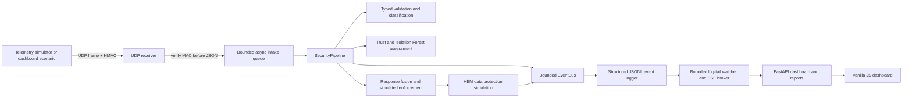
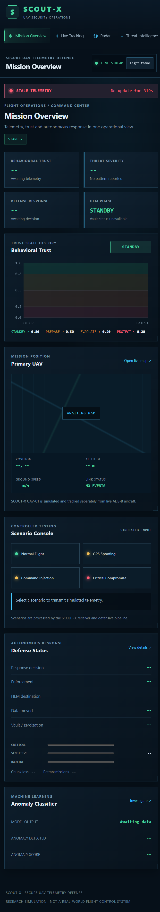
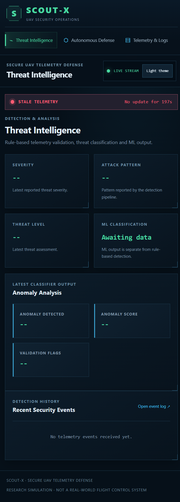

# SCOUT-X

[](https://github.com/Bigsnack7/SCOUT-X/actions/workflows/ci.yml)


**Secure Command and Operations for UAV Telemetry — Exfiltration Defense**

SCOUT-X is a Python simulation and research prototype for inspecting UAV-like
telemetry, scoring trust, simulating defensive responses, and protecting
simulated mission data. It does not control a real aircraft or provide a real
radio transport.

## Quick start (about 10 minutes)

You need Python 3.11 or newer. From the repository root:

1. Create and activate a virtual environment:

   ```powershell
   python -m venv .venv
   .\.venv\Scripts\Activate.ps1
   ```

   On macOS/Linux, activate with `source .venv/bin/activate`.

2. Install runtime dependencies and create a private local configuration:

   ```powershell
   python -m pip install -r requirements.txt
   Copy-Item .env.example .env
   python -c "from pathlib import Path; import secrets; p=Path('.env'); s=p.read_text(); s=s.replace('SCOUTX_NETWORK__TELEMETRY_SHARED_SECRET=', 'SCOUTX_NETWORK__TELEMETRY_SHARED_SECRET='+secrets.token_hex(32), 1); s=s.replace('SCOUTX_DASHBOARD__API_KEY=', 'SCOUTX_DASHBOARD__API_KEY='+secrets.token_urlsafe(32), 1); p.write_text(s)"
   ```

   Keep `.env` private and untracked. If you already have one, do not overwrite
   it; ensure `SCOUTX_NETWORK__TELEMETRY_SHARED_SECRET` is a private value of
   at least 32 bytes. The receiver and dashboard scenario controls use this
   value to authenticate local UDP frames. The dashboard key enables its
   mutating controls.

3. Open three terminals at the repository root. Activate `.venv` in each.

   **Terminal 1 — receiver**

   ```powershell
   python -m simulation.ground_control.receiver
   ```

   Expected startup includes `[GCS] Listening on 127.0.0.1:9999` and
   `Waiting for authenticated telemetry...`.

   **Terminal 2 — dashboard**

   ```powershell
   python -m dashboard.server
   ```

   Expected startup includes `Uvicorn running on http://127.0.0.1:8000`.
   Open <http://127.0.0.1:8000/>.

   **Terminal 3 — deterministic scenario evaluation**

   ```powershell
   python -m simulation.demo.run_scenarios --headless
   ```

   Expected output is a scenario-results table with detection, false-positive,
   timing, data-protection, flap, and final-state columns. The runner writes
   `docs/scenario_results.md`. This headless runner evaluates scenarios
   in-process; it does not send its packets to the dashboard. For live dashboard
   events, use one of the four dashboard scenario controls while the receiver
   is running. Those controls require the configured dashboard API key.

The receiver refuses to start without the shared telemetry secret. Configuration
is loaded from `.env` and `SCOUTX_...` environment variables; startup rejects
invalid trust thresholds, hysteresis margins, ports, and other constrained
settings. Sensitive dashboard reads and the live stream require the configured
dashboard API key; the browser exchanges it for a short-lived HttpOnly session
cookie.

## What runs



The standalone scenario runner exercises the analysis/response/HEM path directly
with seeded in-process inputs. The dashboard controls instead send authenticated
UDP telemetry to the receiver. These are related demonstrations, not one shared
scenario execution mode.

### Trust state machine

Threshold values are configurable; defaults shown here are the README defaults.
Escalation can skip directly to a more severe state when a score crosses a lower
threshold. Recovery requires clean packets above the relevant threshold plus
hysteresis margin. PROTECT is latched until the authenticated reset succeeds.

```mermaid
stateDiagram-v2
    [*] --> STANDBY
    STANDBY --> PREPARE: trust < 0.80
    STANDBY --> EVACUATE: trust < 0.50
    STANDBY --> PROTECT: trust <= 0.20
    PREPARE --> EVACUATE: trust < 0.50
    PREPARE --> PROTECT: trust <= 0.20
    EVACUATE --> PROTECT: trust <= 0.20
    EVACUATE --> PREPARE: clean packets; trust > 0.50 + margin
    PREPARE --> STANDBY: clean packets; trust > 0.80 + margin
    PROTECT --> STANDBY: authenticated reset; score permits
    PROTECT --> PREPARE: authenticated reset; score permits
    PROTECT --> EVACUATE: authenticated reset; score permits
```



Recovery transitions require the configured number of consecutive clean packets.
The authenticated reset is a local simulation control requiring both the
dashboard API key and a configured receiver reset token; it does not imply
operator identity management.

## Configuration quick reference

All settings use `SCOUTX_<GROUP>__<FIELD>` environment names and the same names
in `.env`. Values below are defaults from `simulation/config.py`.

| Group | Setting | Default | Purpose |
|---|---|---:|---|
| Network | `NETWORK__HOST` / `NETWORK__UDP_PORT` | `127.0.0.1` / `9999` | Receiver bind address |
| Network | `NETWORK__MAX_DATAGRAM_SIZE_BYTES` | `4096` | Maximum authenticated UDP frame |
| Network | `NETWORK__RECEIVER_QUEUE_CAPACITY` | `128` | Bounded pending-frame queue |
| Network | `NETWORK__TELEMETRY_SHARED_SECRET` | Empty; required by receiver | HKDF-derived UDP HMAC key input; use a random secret |
| Trust | `TRUST__PROTECT_THRESHOLD` / `EVACUATE_THRESHOLD` | `0.20` / `0.50` | Escalation boundaries |
| Trust | `TRUST__PREPARE_THRESHOLD` / `STANDBY_THRESHOLD` | `0.80` / `0.80` | PREPARE/STANDBY boundary |
| Trust | `TRUST__HYSTERESIS_MARGIN` | `0.10` | Additional score required for recovery |
| Trust | `TRUST__RECOVERY_RATE` / `RECOVERY_CLEAN_PACKETS` | `0.02` / `3` | Per-clean-packet recovery and streak |
| Trust | `TRUST__RESET_TOKEN` | Empty | Required for PROTECT reset |
| Validation | `VALIDATION__MAX_TELEMETRY_PAYLOAD_BYTES` | `2048` | JSON payload size ceiling |
| Validation | `VALIDATION__STALE_TIMESTAMP_SKEW_SECONDS` | `60` | Accepted timestamp skew |
| Validation | `VALIDATION__REPLAY_WINDOW_SIZE` | `64` | Per-drone packet history |
| Validation | `VALIDATION__GPS_JUMP_LIMIT_M` | `20` m | GPS jump tolerance |
| Validation | `VALIDATION__MAX_ALTITUDE` / `MAX_SPEED` | `100` / `120` | Physical field ceilings |
| HEM | `HEM__CHUNK_SIZE` / `RETRY_LIMIT` | `1024` / `3` | Simulated transfer chunk and retry settings |
| HEM | `HEM__TRANSFER_BUDGET` | `20000` bytes | Per-cycle transmission budget |
| HEM | `HEM__PEER_DISTANCE_LIMIT` | `2000` m | Peer eligibility limit |
| HEM | `HEM__PACKET_LOSS_RATE` / `TAMPER_RATE` | `0` / `0` | Seedable transport fault simulation |
| ML | `ML__CONTAMINATION` / `N_ESTIMATORS` | `0.10` / `200` | Isolation Forest parameters |
| ML | `ML__TRAINING_WINDOW` / `RISK_THRESHOLD` | `8` / `0.90` | Training sample count and alert threshold |
| Dashboard | `DASHBOARD__HOST` / `PORT` | `127.0.0.1` / `8000` | Web server bind address |
| Dashboard | `DASHBOARD__API_KEY` | Empty | Required for sensitive reads and mutating API routes |
| Dashboard | `DASHBOARD__ALLOWED_ORIGINS` | Localhost origins | CORS allowlist |
| Dashboard | `DASHBOARD__REQUEST_RATE_LIMIT_PER_MINUTE` | `120` | Per-source request limit |
| Logging | `LOGGING__DIRECTORY` / `ATTACK_LOG` | `logs` / `attack_log.jsonl` | Runtime event log location |
| Logging | `LOGGING__MAX_FILE_BYTES` / `MAX_TOTAL_BYTES` | `5 MiB` / `30 MiB` | Rotating log limits |

`requirements.txt` contains pinned runtime packages. `requirements-dev.txt`
adds pytest, coverage, Ruff, mypy, pre-commit, and dependency-audit tools.
See [.env.example](.env.example) for the full set of supported fields and
[docs/ARCHITECTURE.md](docs/ARCHITECTURE.md) for component responsibilities.

## Project layout

```text
SCOUT-X/
├── dashboard/                  # FastAPI API and static vanilla-JS UI
│   ├── app.js
│   ├── index.html
│   ├── server.py
│   └── style.css
├── simulation/
│   ├── analysis/               # Attack classification and event analysis
│   ├── demo/                   # Seeded declarative scenario runner
│   ├── ground_control/         # Authenticated UDP receiver and pipeline
│   ├── hem/                    # Simulated data vault, crypto, peers, transfer
│   ├── legacy_tcp/             # Older TCP demonstration, not main UDP pipeline
│   ├── logging/                # Thread-safe JSONL event logging
│   ├── ml/                     # Isolation Forest and signal fusion
│   ├── reporting/              # Markdown/HTML/PNG report generation
│   ├── runner/                 # Older standalone telemetry sender
│   ├── security/               # Auth, schema, trust, and response policy
│   ├── telemetry/              # Synthetic telemetry source
│   └── validators/             # Physical-consistency checks
├── simulation_tests/           # Separate experimental Gazebo/Isaac/MuJoCo samples
├── tests/                      # Pytest suites mirroring maintained modules
├── scripts/
│   ├── evaluate_ml.py
│   └── verify_log.py
├── docs/
│   ├── API.md
│   ├── ARCHITECTURE.md
│   ├── THREAT_MODEL.md
│   ├── ml_evaluation.md
│   └── scenario_results.md
├── screenshots/                # Captures of the running dashboard
├── logs/                       # Ignored runtime logs; .gitkeep is tracked
├── totp_test/                  # Standalone command/TOTP demonstration
├── .github/workflows/ci.yml
├── .pre-commit-config.yaml
├── AUDIT.md
├── CONTRIBUTING.md
├── .env.example
├── Dockerfile
├── docker-compose.yml
├── Makefile
├── pyproject.toml
├── requirements.txt
├── requirements-dev.txt
├── render-requirements.txt
├── render-start.sh
└── README.md
```

`attack_log.jsonl`, `hem_log.jsonl`, and `trust_events.jsonl` are the configured
runtime log names. They live under ignored `logs/`; this repository does not use
the old root-level `attack_logs.json` filename.

## Dashboard screenshots

These are captures of the actual dashboard served by `dashboard.server`, not
design mockups. They show the dashboard with no telemetry connected, including
the expected stale-data warning; panels populate when the receiver is running
and a dashboard scenario is launched.





The threat model, API contract, and detailed module/data-flow descriptions are
in [docs/THREAT_MODEL.md](docs/THREAT_MODEL.md), [docs/API.md](docs/API.md), and
[docs/ARCHITECTURE.md](docs/ARCHITECTURE.md).

## Tests and development

```powershell
python -m pip install -r requirements-dev.txt
python -m pytest
ruff check .
ruff format --check .
mypy --follow-imports=silent
```

The configured CI matrix runs Python 3.11 and 3.12 with Ruff, mypy, pytest
coverage (80% minimum), and `pip-audit`. `make test`, `make lint`,
`make run-receiver`, `make run-dashboard`, `make run-demo`, and `make evaluate`
are available where Make is installed. Install local hooks with
`pre-commit install`.

## Troubleshooting

| Symptom | Check |
|---|---|
| Receiver exits with a telemetry secret error | Set a random `SCOUTX_NETWORK__TELEMETRY_SHARED_SECRET` of at least 32 bytes in `.env`; keep the same value for sender and receiver. |
| Sender reports authentication failures | Confirm both processes load the same `.env`, the UDP host/port match, and the sender sends framed packets via `TelemetryAuthenticator`. |
| Address/port is already in use | Stop the other receiver/dashboard process or configure `SCOUTX_NETWORK__UDP_PORT` / `SCOUTX_DASHBOARD__PORT`; restart all affected processes. |
| Dashboard controls return 503/401 | Configure `SCOUTX_DASHBOARD__API_KEY` and supply it as `X-API-Key`; PROTECT reset additionally needs `SCOUTX_TRUST__RESET_TOKEN`. |
| Dashboard shows no telemetry | Start the receiver before a dashboard scenario; the standalone `--headless` scenario runner does not publish to the dashboard. |
| A timestamp or packet is rejected | Check the system clock, monotonic sequence numbers, required fields, configured timestamp skew, and physical limits. Rejection reason codes are in the receiver output and event stream. |
| Live aircraft/map tiles are missing | The optional ADS-B feed and map tiles need internet access; they are not required for local telemetry simulation. |
| Settings fail during startup | Review `.env` for typos and threshold order. Valid trust order is `0 <= protect < evacuate < prepare == standby <= 1`; hysteresis must be smaller than each distinct threshold gap. |
| Log verification fails | Use `python scripts/verify_log.py logs/attack_log.jsonl`; retain the integrity sidecar and rotated segments together. Hash chains are tamper-evident, not tamper-proof. |

## Scope, safety, and security limitations

The receiver uses shared-secret HMAC authentication, schema/replay checks,
bounded queues, and simulated responses. HEM uses AES-GCM/HKDF and simulated
transport. This is not a real flight-control, radio, or safety system. Python
cannot guarantee forensic memory erasure, environment variables are not a
production secret manager, and the shared-secret design does not provide
individual device identity or key rotation. See
[docs/THREAT_MODEL.md](docs/THREAT_MODEL.md) before interpreting any security
claim.

## Planned / not implemented

The following capabilities are intentionally not implemented in this
simulation:

- Real flight-control commands, autonomous aircraft maneuvering, or safety
  decisions.
- Real radio hardware, air-to-ground transport, or remote peer delivery.
- Forensic cryptographic erasure from Python process memory.
- Production identity management, per-device credentials, and key rotation.
- ML performance certification on real aircraft telemetry or unseen attack
  classes.

The dashboard's defense view is therefore labelled **Simulated Defense** and
shows pipeline response/enforcement labels only.

## Attribution, changes, and license status

This repository is a fork of the [upstream SCOUT-X project](https://github.com/SCOUT-X-PROJECT/SCOUT-X).
Upstream attribution is retained: **SCOUT-X Project Team**. The original README
describes SCOUT-X as an academic cybersecurity and UAV security project.

### Changes from upstream

This fork adds or substantially revises centralized validated configuration,
authenticated and bounded UDP intake, structured telemetry validation and trust
state transitions, HEM cryptographic/transfer simulation, the ML secondary
signal, dashboard APIs and UI, JSONL hash-chain logging, reports, scenario
evaluation, tests, and engineering/deployment documentation.

### License check

At the time this documentation was written, the upstream repository exposed no
`LICENSE` file and GitHub reported no repository license; this fork also has no
`LICENSE` file. No license is inferred or added here. Attribution is not a
license grant. Confirm usage and redistribution rights with the upstream
copyright holders before redistributing this fork.

---

SCOUT-X remains an academic cybersecurity and UAV-security simulation, not an
operational aircraft system.
