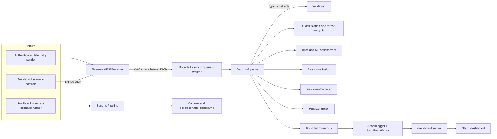
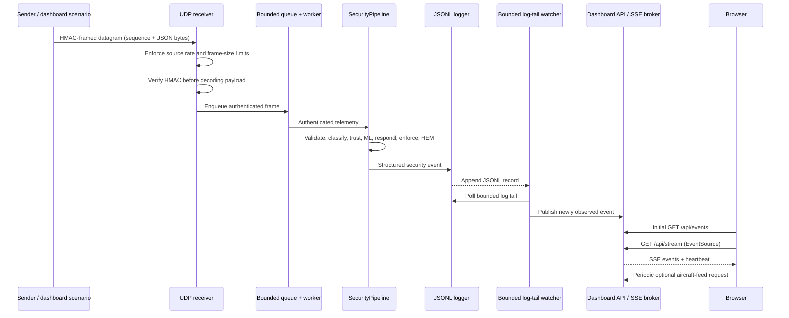

# SCOUT-X architecture

This document describes the code currently in the repository. The system is a
local simulation: simulated enforcement labels do not issue commands to an
aircraft, and `SimTransport` is not a network transport.

## Runtime shape

The `H` path uses the same `SecurityPipeline` as the receiver, with a simulated
source and virtual clock. It does not publish to the separate dashboard
process. The dashboard's named scenarios are a separate producer that submits
signed UDP frames to `U`; that process consumes the bounded JSONL bridge because
an in-process event bus cannot cross a process boundary.

## Packet and dashboard sequence

## Module-by-module guide

### Dashboard

| Module | Responsibility | Main callers/consumers |
|---|---|---|
| [`dashboard/server.py`](../dashboard/server.py) | FastAPI routes, request limits/rate limiting, CORS/security headers, API-key checks, bounded event-tail reading, SSE broker, scenario sender, report export, static asset serving. | Browser, dashboard scenario controls, local operator. |
| [`dashboard/index.html`](../dashboard/index.html), [`dashboard/app.js`](../dashboard/app.js), [`dashboard/style.css`](../dashboard/style.css) | Static vanilla-JS command dashboard, charts/track/timeline/HEM panels, SSE reconnect and refresh behavior, scenario and report controls. | Served by `dashboard.server`. |

### Receiver and security pipeline

| Module | Responsibility | Main callers/consumers |
|---|---|---|
| [`simulation/ground_control/receiver.py`](../simulation/ground_control/receiver.py) | Builds the application pipeline and runs it with signal-aware shutdown; connects analysis, trust, ML, response, HEM, logging, and reports. | `python -m simulation.ground_control.receiver`; Render startup. |
| [`simulation/ground_control/udp_receiver.py`](../simulation/ground_control/udp_receiver.py) | UDP socket intake; source token buckets, frame bounds, HMAC verification, bounded queue, worker isolation, authenticated control frames, structured intake events. | `receiver.py`; integration tests. |
| [`simulation/security/telemetry_auth.py`](../simulation/security/telemetry_auth.py) | HMAC-SHA256 frame encoding/verification; derives a dedicated MAC key with HKDF. | UDP receiver and dashboard/telemetry senders. |
| [`simulation/security/telemetry_schema.py`](../simulation/security/telemetry_schema.py) | Strict Pydantic packet contract and machine-readable validation result/reason enums. | Middleware, receiver, classifiers. |
| [`simulation/security/telemetry_middleware.py`](../simulation/security/telemetry_middleware.py) | Parses bounded JSON, applies schema, freshness, sequence/replay and consistency checks, and updates trust/classification evidence. | Receiver worker; scenario runner tests. |
| [`simulation/security/trust_engine.py`](../simulation/security/trust_engine.py) | Enum state machine, weighted attack penalties, bounded recovery, hysteresis, transition events, authenticated PROTECT reset. | Middleware; response pipeline; HEM phase input. |
| [`simulation/analysis/attack_classifier.py`](../simulation/analysis/attack_classifier.py) | Maps structured validation results to attack types and recognizes bounded-history flood/multi-vector signals. | Middleware. |
| [`simulation/analysis/attack_analyzer.py`](../simulation/analysis/attack_analyzer.py) | Adds pattern and severity fields from enriched packet/validation evidence. | Receiver processing callback. |
| [`simulation/analysis/threat_stats.py`](../simulation/analysis/threat_stats.py) | Tracks and prints aggregate threat statistics for the receiver session. | `receiver.py`. |
| [`simulation/analysis/threat_dashboard.py`](../simulation/analysis/threat_dashboard.py) | Older command-line parser for the local JSONL log; not the FastAPI dashboard. | Run directly as a legacy utility. |
| [`simulation/security/response_engine.py`](../simulation/security/response_engine.py) | Chooses a simulation response based on trust, attack persistence, and severity. | Receiver and in-process scenario runner. |
| [`simulation/security/enforcer.py`](../simulation/security/enforcer.py) | Maps response decisions to simulated action labels such as `ISOLATED`, `RESTRICTED`, and `LANDING`; no flight-control command is sent. | Receiver and scenario runner. |
| [`simulation/security/defense_logic.py`](../simulation/security/defense_logic.py) | Older local defense helper used by the standalone sender path; not the main receiver enforcer. | `simulation/runner/simulation_runner.py`. |
| [`simulation/validators/consistency_validator.py`](../simulation/validators/consistency_validator.py) | Checks consecutive accepted telemetry for time, location/speed, altitude-rate, and battery consistency. | Telemetry middleware. |
| [`simulation/validators/motion_validator.py`](../simulation/validators/motion_validator.py) | Shared physical motion and geographic distance calculations. | Consistency checks and related tests. |

### Telemetry, scenarios, and ML

| Module | Responsibility | Main callers/consumers |
|---|---|---|
| [`simulation/telemetry/telemetry_engine.py`](../simulation/telemetry/telemetry_engine.py) | Produces a synthetic, configured telemetry stream with sequence and timestamp fields. | Standalone sender and tests. |
| [`simulation/demo/run_scenarios.py`](../simulation/demo/run_scenarios.py) | Declarative, seeded attack/benign scenario catalog; in-process runner and per-scenario metrics. | `python -m simulation.demo.run_scenarios`; regression tests. |
| [`simulation/ml/anomaly_detector.py`](../simulation/ml/anomaly_detector.py) | Rolling feature engineering and StandardScaler/IsolationForest pipeline; model persistence and risk calibration. | Receiver; `scripts/evaluate_ml.py`. |
| [`simulation/ml/fusion.py`](../simulation/ml/fusion.py) | Limits ML to a secondary response signal; it cannot independently select the most severe actions. | Receiver. |
| [`scripts/evaluate_ml.py`](../scripts/evaluate_ml.py) | Generates labeled simulator data and writes ML evaluation metrics. | Developer/CI command. |

### HEM and records

| Module | Responsibility | Main callers/consumers |
|---|---|---|
| [`simulation/hem/controller.py`](../simulation/hem/controller.py) | Coordinates HEM phase, data selection, transfer/resume, logging, and best-effort cleanup. | Receiver and scenario runner. |
| [`simulation/hem/vault.py`](../simulation/hem/vault.py) | Prioritized in-memory data items, AES-GCM sealing, transfer status, mutable-buffer cleanup. | HEM controller. |
| [`simulation/hem/crypto.py`](../simulation/hem/crypto.py) | HKDF purpose-separated session keys, transfer context and AAD helpers. | HEM and encrypted transfer code. |
| [`simulation/hem/exfil.py`](../simulation/hem/exfil.py) | Chunk encryption/decryption, authenticated manifest, priority order, budget, retry and ACK state. | HEM controller and `SimTransport`. |
| [`simulation/hem/peers.py`](../simulation/hem/peers.py) | TOTP and replay guards, peer scoring/eligibility, deterministic peer decision explanation. | HEM controller. |
| [`simulation/hem/transport.py`](../simulation/hem/transport.py) | In-memory simulated base/peer delivery, loss/tamper injection, handoff spool. | HEM transfer code. |
| [`simulation/logging/attack_logger.py`](../simulation/logging/attack_logger.py) | Converts pipeline outputs into structured events. | Receiver and standalone sender. |
| [`simulation/logging/jsonl.py`](../simulation/logging/jsonl.py) | Validated append-only JSONL writes, rotation/retention, redaction, local hash chain. | Event loggers and `scripts/verify_log.py`. |
| [`simulation/reporting/report_generator.py`](../simulation/reporting/report_generator.py) | Builds Markdown/HTML and trust graph PNG reports from available log events. | Receiver shutdown and report command. |
| [`simulation/analysis/report_generator.py`](../simulation/analysis/report_generator.py) | Compatibility re-export of the report API. | Older imports. |

### Configuration and compatibility/demo code

| Module/path | Responsibility and status |
|---|---|
| [`simulation/config.py`](../simulation/config.py) | Validated Pydantic settings groups; loads `.env` and `SCOUTX_...` environment values. |
| [`simulation/runner/simulation_runner.py`](../simulation/runner/simulation_runner.py) | Older long-running sender/demo with its own local validation path; not required for the recommended three-command flow. |
| [`simulation/legacy_tcp/`](../simulation/legacy_tcp) | Older TCP sender/receiver demonstration. Separate from the authenticated UDP pipeline; do not infer UDP security properties for it. |
| [`totp_test/`](../totp_test) | Standalone authenticated-command/TOTP demo. It is not the dashboard receiver protocol. |
| [`simulation_tests/`](../simulation_tests) | Experimental standalone Gazebo/Isaac/MuJoCo sample scripts and notes; these are not the core runtime. |
| [`scripts/verify_log.py`](../scripts/verify_log.py) | Verifies the retained local hash-chain log segments and integrity metadata. |
| [`tests/`](../tests) | Pytest suites for maintained runtime modules, APIs, crypto, receiver, configuration, and scenarios. |

## Configuration and trust boundaries

Settings are loaded once at import from a project-root `.env` plus environment
variables. `SCOUTX_` is the prefix and `__` separates nested group/field names.
Secrets include the telemetry shared secret, dashboard API key, optional HEM
secret, TOTP demo secret, and PROTECT reset token. See `.env.example` and the
README quick-reference table.

The main network trust boundary is the UDP frame verifier. Authentication is
performed before JSON decoding; authenticated content is still untrusted and
must pass strict schema, timestamp, replay, and physical-consistency checks.
Dashboard API-key authentication protects mutation endpoints; it does not
authenticate all read-only dashboard APIs or provide per-user identity.

## Local observability

- Runtime events are appended under `logs/` as JSON Lines and rotated within
  configured limits.
- Hash chaining can expose changes to retained log entries when the associated
  local integrity metadata remains intact; it is not a remote, signed audit
  service.
- The dashboard's background watcher polls a configured bounded tail and
  pushes newly observed events into bounded per-client SSE queues. The browser
  makes an initial event-tail request, then receives events through
  Server-Sent Events. The browser separately refreshes optional aircraft-feed
  data periodically and updates the stale-data indicator once per second.
- The report generator summarizes only events present in its input logs.
