# SCOUT-X Wiring Plan

## Scope and current-state conclusion

This is a Phase 1 design document only. It records the wiring that exists
today and proposes a migration target; it does not change runtime behavior.

The current system has two related but different execution paths:

1. The live receiver path starts at authenticated UDP, then performs validation,
   classification, trust, analysis, ML, response, enforcement, HEM, and logging
   inside one callback.
2. The headless scenario path constructs similar components in-process and
   executes them directly. It does not publish to the live receiver or
   dashboard.

The dashboard scenario controls are a third path: the dashboard builds raw
packet dictionaries, encodes them into authenticated UDP frames, and sends
them to the receiver. The browser therefore observes the receiver's log output,
not the scenario runner's in-process state.

## Actual current data flow

```mermaid
flowchart LR
    Sender[Telemetry sender or dashboard scenario] -->|bytes over UDP| UDP[TelemetryUDPReceiver]
    UDP -->|authenticated queued frame| Middleware[SecurityMiddleware]
    Middleware -->|ValidationResult| Callback[receiver.process_result]
    Callback -->|dict from model_dump plus derived fields| Analyzer[AttackAnalyzer]
    Callback -->|dict| ML[TelemetryAnomalyDetector]
    Callback -->|dict| Response[ResponseEngine]
    Response -->|string| Fusion[fuse_ml_signal]
    Fusion -->|dict response| Enforcer[ResponseEnforcer]
    Enforcer -->|mutated dict| HEM[HEMController]
    HEM -->|dict| Logger[AttackLogger]
    Logger -->|JSONL files| Watcher[dashboard._watch_event_log]
    Watcher -->|EventResponse queues| SSE[FastAPI SSE]
    SSE --> Browser[Vanilla JS dashboard]

    Scenarios[run_scenarios] -->|raw dicts| LocalMiddleware[SecurityMiddleware]
    LocalMiddleware --> LocalResponse[ResponseEngine]
    LocalResponse --> LocalHEM[HEMController]
    LocalHEM --> Metrics[Scenario metrics/files]
```



### Live receiver path

1. [`TelemetryUDPReceiver`](../simulation/ground_control/udp_receiver.py)
   owns the UDP socket, source token buckets, frame-size checks, HMAC
   verification, persistent replay cache, bounded `asyncio.Queue`, and worker
   lifecycle. Its input is an untrusted datagram (`bytes`) plus a socket
   address. Authenticated frames are queued as `_QueuedDatagram`; rejected
   intake conditions are retained as mutable dictionaries in a bounded
   `events` deque.
2. The receiver worker calls
   [`SecurityMiddleware.validate_telemetry`](../simulation/security/telemetry_middleware.py)
   with the authenticated payload bytes. The middleware parses JSON and
   constructs a Pydantic [`TelemetryPacket`](../simulation/security/telemetry_schema.py)
   or returns a [`ValidationResult`](../simulation/security/telemetry_schema.py).
   The middleware also owns per-drone ordered windows and calls
   [`validate_consistency`](../simulation/validators/consistency_validator.py).
3. Middleware classification is performed by
   [`AttackClassifier`](../simulation/analysis/attack_classifier.py), using the
   `ValidationResult` and an internal bounded history. The resulting attack
   type is copied into the `ValidationResult` as a string.
4. [`receiver.create_receiver`](../simulation/ground_control/receiver.py)
   registers a callback, `process_result`. For accepted packets, that callback
   converts the Pydantic packet to a mutable raw dictionary with
   `model_dump()`, then adds `seq`, `gps`, trust fields, validation fields,
   scenario data, and classification fields. Rejected results are printed and
   return before analysis, ML, response, HEM, or logging.
5. The callback calls
   [`AttackAnalyzer.analyze`](../simulation/analysis/attack_analyzer.py) with
   the enriched dictionary. The analyzer stores dictionaries in a list and
   returns a pattern/severity dictionary.
6. Clean dictionaries are accumulated in a local list until the configured ML
   window is reached. [`TelemetryAnomalyDetector`](../simulation/ml/anomaly_detector.py)
   is trained once, then predicts from the same mutable dictionary. Its result
   is another dictionary.
7. [`ResponseEngine.decide`](../simulation/security/response_engine.py) consumes
   the dictionary and returns a response string. It maintains its own attack
   streak and reads trust thresholds from global settings.
8. [`fuse_ml_signal`](../simulation/ml/fusion.py) consumes the response string
   and ML dictionary, returning a fusion dictionary. The callback writes that
   result back into the packet dictionary.
9. [`ResponseEnforcer.enforce`](../simulation/security/enforcer.py) mutates the
   dictionary in place and adds an `enforced` string. It prints action messages.
10. [`HEMController.on_packet`](../simulation/hem/controller.py) consumes the
    enriched dictionary, maintains its own phase/recovery/session/transfer state,
    writes HEM JSONL records directly, and returns a HEM result dictionary.
11. [`AttackLogger.log`](../simulation/logging/attack_logger.py) extracts fields
    from the packet, pattern, response, validation, and HEM dictionaries, then
    writes a structured event through [`JsonlEventWriter`](../simulation/logging/jsonl.py).
    Trust transition events are sent separately through a callback registered on
    `SecurityMiddleware`.
12. [`dashboard.server`](../dashboard/server.py) reads a bounded tail of the
    attack JSONL file into `EventResponse` models. A background watcher polls the
    same file and publishes newly seen events to bounded SSE queues. The dashboard
    therefore consumes files, not a live pipeline API.

### Dashboard scenario path

[`dashboard.server.send_scenario`](../dashboard/server.py) generates raw packet
dictionaries using `normal_packet` or `attack_packet`, sends a
`scenario_start` control frame, sends authenticated telemetry UDP frames, and
sends a completion frame. The receiver resets its callback-local analyzer,
response engine, enforcer, stats, vault, and HEM controller when it receives
the start control. The dashboard does not receive a typed result from this
operation; it waits for an authenticated completion acknowledgement and later
reads the log tail.

The dashboard also contains derived display logic: it parses stored event
fields, selects latest records, computes pagination/filtering, and uses event
fields to display trust and phase. It does not currently call the trust engine,
but the source of truth is indirectly reconstructed from files rather than
read from a state store.

### Headless scenario path

[`simulation.demo.run_scenarios`](../simulation/demo/run_scenarios.py) creates
`SecurityMiddleware`, `ResponseEngine`, `HEMController`, a seeded random
generator, and scenario-local metric state. It feeds raw simulator dictionaries
through middleware and then calls response/HEM components directly. This path
does not use [`TelemetryUDPReceiver`](../simulation/ground_control/udp_receiver.py),
the receiver callback, `AttackLogger`, the dashboard event broker, or the live
ML training callback. Its metrics and reports are therefore comparable but not
identical to a live dashboard run.

## Coupling smells and current risks

### Raw dictionaries cross stage boundaries

The main callback converts typed validation output back to `dict[str, Any]`.
`AttackAnalyzer`, `ResponseEngine`, `ResponseEnforcer`, `HEMController`, and
`AttackLogger` communicate through shared mutable dictionaries with optional
keys. A missing or differently named key becomes a runtime fallback rather than
a contract error. The same issue exists in the scenario runner.

### Log files are an integration API

- The dashboard uses `read_events()` and `_watch_event_log()` to poll
  `attack_log.jsonl` rather than subscribing to the receiver.
- The report generator reads rotated JSONL files directly.
- `HEMController` creates its own `JsonlEventWriter` and writes HEM records
  independently of `AttackLogger`.
- `next_sequence()` scans the dashboard log to choose the next sender
  sequence.

This creates hidden timing and persistence dependencies: a dashboard view can
lag behind processing, a log rotation can affect sequence selection, and a
partially written or externally edited file becomes a runtime integration
boundary.

### Global mutable state and import-time configuration

- `settings` is a module-level singleton imported by nearly every stage.
- `TelemetryUDPReceiver` constructor defaults read `settings` when the module
  is imported.
- `SecurityMiddleware`, `TrustScoreEngine`, `AttackClassifier`,
  `ResponseEngine`, `AttackLogger`, and `HEMController` create mutable state
  internally without an injected owner.
- `dashboard.server` has module-level `scenario_state`, counters,
  `event_broker`, `rate_limiter`, and configuration-derived paths.
- `run_scenarios` and the receiver each create their own trust, response, and
  HEM state.

The current locks and bounded containers reduce race and memory risk, but they
do not establish one authoritative state owner.

### Duplicated policy and threshold logic

Trust thresholds are applied in at least:

- [`TrustScoreEngine`](../simulation/security/trust_engine.py), the intended
  state machine.
- [`ResponseEngine`](../simulation/security/response_engine.py), which checks
  `trust <= protect_threshold`.
- [`HEMController._target_phase`](../simulation/hem/controller.py), which maps
  trust to HEM phases.
- [`HEMController._next_phase`](../simulation/hem/controller.py), which has
  separate recovery/hysteresis logic.
- Scenario metrics and dashboard display/configuration code.

The trust engine state and HEM phase can therefore disagree at a boundary or
after recovery. Response and HEM decisions also use strings rather than one
shared policy object.

### Hidden ordering dependencies

- HMAC verification and replay checks must happen before JSON parsing and
  validation; this ordering is embedded in the UDP receiver.
- `SecurityMiddleware` must retain an accepted packet before the next packet
  arrives so consistency checks have a previous sample.
- ML training depends on enough clean callback invocations before prediction is
  considered ready.
- `AttackAnalyzer` must run before `ResponseEngine`, because response streak
  logic reads analyzer pattern/severity fields.
- Fusion must happen after deterministic response and before enforcement.
- HEM must run after enforcement because it reads the chosen response/action.
- Dashboard `scenario_end` acknowledgement is meaningful only after the
  receiver has drained its queue.
- Dashboard SSE is eventually consistent with the logger because the watcher
  polls files.

None of these orderings is represented by a typed pipeline contract; they are
encoded in callback order and mutable dictionary construction.

### Concrete-class coupling and layering

There are no obvious Python import cycles in the current package, but stages
import concrete implementations and global configuration directly:

- Receiver imports concrete `AttackAnalyzer`, `ResponseEngine`,
  `ResponseEnforcer`, `HEMController`, `AttackLogger`, and ML detector.
- Middleware imports concrete `AttackClassifier`, `TrustScoreEngine`, and the
  concrete consistency validator function.
- HEM imports concrete `JsonlEventWriter`, `PeerRegistry`, and `SimTransport`.
- Reporting imports concrete JSONL parsing and verification functions.
- Dashboard imports concrete `TelemetryAuthenticator` and reads concrete log
  files.

This makes isolated substitution difficult and causes tests to construct large
real component graphs where a fake protocol would be sufficient.

### Dashboard and reporter duplication

The dashboard and report generator each parse/normalize event records. The
dashboard flattens `details` into `EventResponse`; the report generator
flattens `JsonLogEntry` into dictionaries. Both independently interpret
`state`, `trust`, `pattern`, HEM fields, and timestamps.

### Error handling is split across stages

The UDP boundary catches malformed datagrams, but the callback path has no
single stage-error policy. A failure from ML, response, enforcer, HEM, or the
logger can propagate through the worker callback differently from a validation
rejection. There is no common `StageError` contract carrying correlation
context and a guaranteed fail-closed transition.

### Correlation is incomplete

Sequence numbers are present in packet/log details, but there is no session ID
or correlation ID carried consistently through validation, classification, ML,
response, enforcement, HEM, log entries, and dashboard messages. Trust
transition logs use their own event identity and timestamp without a packet
correlation field.

## Target design

### One owner of stage order

Introduce `SecurityPipeline` as the only coordinator. Its `process` method
owns this fixed order:

```text
ingest -> validate -> classify -> trust -> ML -> fuse -> respond
        -> enforce -> HEM -> log -> publish
```

Stages receive inputs and return outputs; they never invoke another stage.
The pipeline owns correlation creation, failure handling, state commits, and
event publication.

The receiver becomes an authenticated/bounded source that hands a typed
`TelemetryPacket` (or typed ingest rejection) to the pipeline. The scenario
runner uses the same pipeline with a simulated source. Dashboard controls
remain transport adapters, not a second implementation of security behavior.

### Typed contracts

`simulation/contracts.py` should define frozen dataclasses or strict Pydantic
models for:

- `TelemetryPacket`: validated telemetry plus `CorrelationId`.
- `ValidationResult`: accepted/rejected result, reason, offending field, and
  packet where applicable.
- `ThreatAssessment`: attack type, severity, pattern, evidence, and history
  summary.
- `TrustUpdate`: previous/current score and state, transition, and reason.
- `MlAssessment`: readiness, risk, anomaly, model metadata, and feature
  evidence.
- `ResponseDecision`: pure response level/reason and whether ML contributed.
- `EnforcementResult`: simulated action, status, and error evidence.
- `HemStatus`: phase, destination, transfer outcome, progress, and
  zeroization report.
- `SecurityEvent`: event type, severity, UTC time, correlation ID, trust/state,
  and typed details.
- `StageError`: stage name, correlation ID, safe public message, and internal
  diagnostic reference.
- `PipelineResult`: all stage outputs plus final `SystemState` version.

No raw dictionaries, filenames, global state objects, or mutable packet
accumulators should cross these boundaries.

### Single state store

`SystemState` is a thread-safe, versioned store owned and written only by the
pipeline. It contains the authoritative trust score/state, latest telemetry
summary, latest threat/ML/response/HEM results, and lifecycle/readiness status.
`snapshot()` returns an immutable read-only view. Dashboard, logger, reporter,
and metrics consumers subscribe to snapshots/events; they do not recompute
trust, phase, or response.

### Event bus

An in-process `EventBus` publishes typed `SecurityEvent` and state-change
notifications. Each subscriber has a bounded queue and an explicit overflow
policy (drop-oldest with a loss counter, or disconnect). Publishing is
non-blocking from the pipeline's perspective. Logger and reporter subscribers
persist events; dashboard subscribers stream them; tests can use a collecting
subscriber.

### Dependency injection

Constructors receive settings/config, clock, RNG, and collaborators. Importing
a module must not open files, bind sockets, create log writers, or read
environment-dependent resources. Entry points assemble the object graph once.
The pipeline accepts protocols for every stage, allowing deterministic fakes
for fault and contract tests.

### Correlation and error policy

At ingest, create a session ID for the running source and combine it with the
packet sequence into a correlation ID. Every contract and emitted event carries
it. If any stage raises:

1. The pipeline catches the exception at the stage boundary.
2. It creates a typed `StageError` with a safe message and correlation ID.
3. It publishes/logs the error without exposing secrets or stack traces.
4. It applies the fail-closed policy: reduce trust, escalate state when policy
   permits, and produce a conservative response/enforcement result.
5. It continues processing later packets.

Expected validation rejections remain normal typed results, not exceptions.

### Lifecycle manager

A lifecycle manager starts resources in dependency order:

1. Validate configuration and create the clock/RNG/session context.
2. Construct state store, event bus, logger, HEM, stages, and pipeline.
3. Run readiness checks for log paths, model availability/readiness, HEM
   collaborators, and dashboard dependencies.
4. Start event subscribers, pipeline workers, receiver, and dashboard.
5. On shutdown, stop intake, drain the bounded pipeline queue, publish a final
   lifecycle event, flush logger/report subscribers, close HEM/transport and
   sockets, then close the event bus.

Startup failure is explicit; shutdown is idempotent and ordered.

## Migration plan

Each step is intentionally small and should leave the existing entry points
working. Run `pytest` after every step and commit before starting the next.
Do not delete legacy files or unique logic until equivalence tests prove the
replacement covers it; ask for approval before any deletion.

1. **Inventory and characterization (Phase 1, this document).** Record current
   calls, data shapes, ordering, logs, globals, and known behavior. No code
   changes beyond this plan.
2. **Add contracts and protocols.** Create
   `simulation/contracts.py` and unit-test immutability, validation, and
   serialization. Add adapters around existing implementations; do not change
   decisions or thresholds.
3. **Add state store and event bus.** Implement versioned snapshots and bounded
   subscribers independently. Add tests for ordering, overflow, and
   thread-safety without routing production traffic yet.
4. **Build `SecurityPipeline` around existing stages.** Adapt the receiver
   callback first. Preserve current stage calls and dictionary adapters inside
   the pipeline temporarily, then expose typed `PipelineResult`.
5. **Move state ownership.** Route trust, response, HEM, and latest telemetry
   state through `SystemState`. Make dashboard reads use snapshots while
   retaining log-tail endpoints for historical data.
6. **Route logger/reporter/dashboard notifications through the bus.** Keep
   bounded file history as persistence, but remove live file polling only after
   event equivalence tests pass.
7. **Route the headless runner through the same pipeline.** Preserve seeded
   scenario metrics and compare old/new results before changing any scenario
   expectations.
8. **Add lifecycle management and fault policy.** Add readiness/shutdown tests,
   stage fault injection, safe `StageError` events, and fail-closed assertions.
9. **Remove duplicate orchestration and dead adapters.** First prove no unique
   behavior remains with call-graph and scenario tests; request confirmation
   before deleting any file that contains unique logic.
10. **Update architecture documentation and prove wiring.** Add contract tests,
    the end-to-end four-scenario test, slow-subscriber test, and import-layer
    test. Update README and `docs/ARCHITECTURE.md` only after the final wiring
    is running.

## Phase 1 acceptance criteria

- This document describes the live receiver, dashboard-control, and headless
  scenario paths separately.
- Every current stage boundary identifies its actual payload type and owner.
- File polling, mutable globals, duplicated thresholds, direct concrete
  imports, and ordering dependencies are called out.
- The target design defines one orchestrator, typed contracts, one state
  owner, bounded event publication, dependency injection, correlation,
  fail-closed stage errors, and lifecycle order.
- No runtime behavior is changed in Phase 1.
